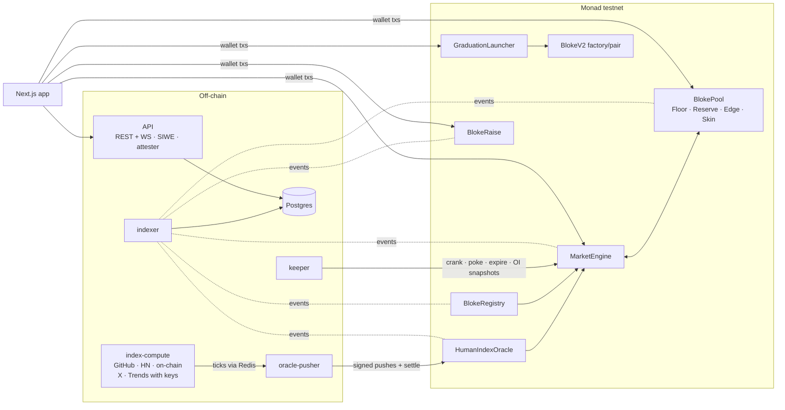

# BLOKE

**Back the work. Short the noise.**

BLOKE is a market for people who build. You can back someone whose work you believe in, or bet against someone who is all talk, and the price moves with what they actually do.

**Try it:** https://bloke-xi.vercel.app (Monad testnet, free test money)

> Testnet only. The money is test money with no value, and the contracts are unaudited.

## What is BLOKE?

Every builder, creator or founder on BLOKE (a "Bloke") has a live score, and you can take a side on it.

- **Back the work.** When someone keeps shipping (code, releases, products, things on chain), their score rises. Back them early and you gain when it does.
- **Short the noise.** When the buzz around someone runs ahead of what they deliver, you can bet the other way.

Each person's score has two halves, and each half is its own market:

- **WORK** measures what they ship: commits, releases, contracts deployed, verified proof of work.
- **HYPE** measures the attention around them: mentions and searches.

The main price blends the two, leaning toward WORK. When WORK is well ahead of HYPE, a person is marked **Underrated**. When HYPE runs ahead of WORK, they're marked **Overhyped**. That gap is where the interesting trades are.

## What you can do

**As a trader**
- Get 10,000 test dollars (tUSDC) in one click. No gas or setup needed.
- Go long or short any person, or their WORK or HYPE alone. There's no leverage, so you can't lose more than you put in.
- Your trade fills at the next price update, about a second later. You pay a small fee only on profit when you close.
- Early, correct calls earn **Rep**, a reputation score shown on the leaderboard.

**As a builder, creator or founder**
- Claim your profile with your own accounts, so nobody else can speak for you.
- Add **proof of work** (contracts, repos, releases, papers, products). Contracts you deployed yourself are verified automatically.
- Earn a share of the trading fees on your markets. Put your own **Skin** in the game to earn more.
- **Raise** from people who believe in you. It's all or nothing: if the goal isn't met, everyone gets their money back.
- When you've proven yourself, **launch your own token**. BLOKE creates it, seeds a trading pool that stays locked for a year, rewards your earliest backers, and vests your share over time.

**As a backer of the market**
- Deposit into the **Pool**, the other side of every trade. The **Floor** earns a fixed rate and is paid first. The **Edge** earns whatever the pool makes and absorbs losses first.

## Why it's different

Most "invest in people" products priced attention, so they rewarded whoever was loudest. BLOKE prices **work**. Its score comes from public signals checked against each person's own history, not from a bonding curve. It's protected against spam and brigading, and nobody can trade their own profile. People appear only if they opt in and claim themselves.

## Learn more

- Product spec and every design decision: [`docs/prd/amendments.md`](docs/prd/amendments.md) (A1–A19)
- Market research: [`docs/research/market-research.md`](docs/research/market-research.md)
- For developers building on the API: [`docs/api.md`](docs/api.md)
- Brand: [`brand.md`](brand.md)

---

The rest of this page is technical: how the system works, how to run it, and where it's deployed.

---

## How it works



- **Index (P3, A16).** `index-compute` polls each Bloke's registered accounts and stores filtered events. It computes `$NAME = 100·(α·sq(ΣwH·zH) + (1−α)·sq(ΣwW·zW))` against each person's own 30-day baseline, and publishes one tick per Bloke. Sources a person has no account on drop out, and the leg renormalises. Blokes without a source on both legs follow a synthetic walk, and the published params document says which mode each Bloke is in.
- **Oracle (P0, A1, A14).** Pushes are EIP-712 signed. Each one is clamped to a 3% step, a 0.6–1.4× band around the 24-hour value, and an absolute range. Lag flags stop anyone trading a catch-up move that's already known. Orders fill two-step at the next push.
- **Engine (P1).** No leverage, one side per market, premium and funding, per-wallet and per-market caps. Fees: 3% of profit at close, part of it to the person (15%, or 25% with Skin).
- **Pool (P2, A15).** Hourly waterfall: the senior Floor earns a fixed rate, the Reserve protects Floor principal, and the junior Edge takes the residual. Edge deposits and redemptions settle in epoch buckets. Skin is the person's own first-loss stake.
- **Graduation (P4, A17).** Eight on-chain checks, then one transaction from the claimed wallet. It deploys a 1B-supply token with CREATE2, seeds and locks a `$NAME/tBLOKE` pool for 365 days, and starts the 200M airdrop to early longs, the 100M backer claims and the person's 150M vesting (90-day cliff, then 365 days). About 4M gas. The AMM is a Solidity 0.8 port of Uniswap V2.
- **Raises (A18).** All or nothing with a hard cap. The person and their linked wallets can't commit. A successful raise counts as backing in the graduation backer allocation.
- **Proof of work (A19, simulated).** Stored off-chain. Contract items are checked against their deployment tx, repos against your linked GitHub. The WORK effect is shown, but not fed to the oracle.

## Layout

| Path | What |
|---|---|
| `contracts/` | Foundry 1.8.7, Solidity 0.8.28 (via-IR), OpenZeppelin 5 AccessManager. Config, oracle, registry, engine, settler, pool, graduation (launcher, token, desk, tBLOKE, LP locker, vesting, Merkle distributor, Rep roots), AMM, raises. `script/Deploy.s.sol` deploys the whole set |
| `packages/index-core` | Pure index math, per-Bloke params, HYPE/WORK spam filters, Rep rules, the synthetic walk |
| `packages/shared` · `packages/sdk` | Chain config, generated ABIs, archetype catalogue · typed REST/WS client and error messages for the frontend |
| `packages/chain-state` | Log reader and engine-state reducer shared by the pusher, keeper and indexer |
| `services/index-compute` | Signal collectors and index computation (P3) |
| `services/oracle-pusher` | Signs pushes and settles pending orders in the same tx |
| `services/keeper` | Expires, settles stragglers, exhausts, profit-caps, pokes funding, cranks pool epochs, snapshots OI for graduation |
| `services/indexer` | Every event into Postgres, up to the Finalized block; runs `db/migrations` on start |
| `services/api` | Stateless REST + WebSocket: SIWE, GitHub/X OAuth, attester (faucet, claim, sources, graduation), raises, proof of work |
| `apps/web` | Next.js 16 + Tailwind v4 + wagmi. Floor, Bloke page, Portfolio, Pool, Raise, Rep, Me, Status |
| `tests/integration` | Both suites against a live deployment, plus `demo/` scripts (graduate a Bloke, open a raise) |
| `scripts/` | Local end-to-end, testnet deploy/services/integration, ABI generation, stipple art renderer |

## Run it

Requirements: Node 24, pnpm 9, Foundry ≥ 1.8 (`foundryup --install v1.8.7`), Postgres and Redis on localhost.

```sh
pnpm install && pnpm -r build
cd contracts && forge test && cd ..          # 90 tests incl. invariants and the full graduation
pnpm -r test                                  # unit tests (index math, engine of index-compute, pusher, keeper, indexer)
scripts/e2e-local.sh                          # Anvil + deploy + every service + both integration suites (19 tests)
```

Frontend: `cd apps/web && cp .env.local.example .env.local && pnpm dev` → http://localhost:3000 (`NEXT_PUBLIC_API_URL`, default `http://localhost:8080`).

### Monad testnet (staging set)

```sh
cp .env.example .env.testnet                  # fill in keys; fund DEPLOYER (≥ 10 MON) and RELAYER (pusher gas)
echo "DATABASE_URL='postgres://…'" > .env.db  # any Postgres; set STAGING_DB_NAME in .env.testnet per deployment
scripts/testnet-deploy.sh                     # writes contracts/deployments/10143-staging.json
scripts/testnet-services.sh                   # index-compute, indexer, pusher, keeper, two API instances
scripts/testnet-integration.sh                # in another terminal
```

- `DATABASE_URL_OVERRIDE=postgres://…` on `testnet-services.sh` and `testnet-integration.sh` points everything at another Postgres, for example a local one while the managed database is down.
- Demo data: in `tests/integration`, run `node demo/graduate.ts` (graduates a demo Bloke end to end) and `node demo/raise.ts` (opens a demo raise). Demo keys are kept in `.state/`.
- Gas: the pusher's relayer spends roughly 1–2 MON an hour on a 45 s heartbeat, with catch-up pushes rate-limited. Check `RELAYER_ADDRESS` before a demo.
- Optional collector keys: `GITHUB_TOKEN` (higher GitHub rate limit), `X_BEARER_TOKEN`, `SERPAPI_KEY`.

## Live staging deployment (Monad testnet, chain 10143)

| Contract | Address |
|---|---|
| HumanIndexOracle | `0xd94653EBEa17a97C860E786A20C43d1143579011` |
| BlokeRegistry | `0xda79064E2B1aAbB8ce54f01c766f2A7bCE31E876` |
| MarketEngine | `0x94E534DdeE9f3481daf1f516B9f16A3fc903bE45` |
| Settler | `0xfEDFB5Ae73739Ca17cFf8705BD5d80f56eB8b206` |
| BlokePool | `0xbb20A4f2FC67CF0C8560cCE296D04926005A884E` |
| ProtocolConfig | `0x9Cab04d526BeEeFA0602606B3BD5da1953727B14` |
| TestUSDC (tUSDC) | `0x27B3Eb0Df9B03fea78459EF038B12d1344207711` |
| GraduationLauncher | `0x5725Fb4E8E5bF13791F9dC6fA3F1FC4B1079f9eC` |
| tBLOKE · BlokeDesk | `0xF5141c5EA65FEd82813ACDF73Ca4f06853F83c50` · `0xE3B062F5e20c75269622e3211A534F5718F500a9` |
| BlokeV2 factory · router | `0xD5432B401721208B48Ca067584F926BDEd3503dF` · `0x77fb1812388cA581b093291A991379b059Cb749B` |
| LPLocker · VestingStream · MerkleDistributor | `0x8712f7fCc98f740bE80cC721B010108bB1a34f60` · `0xA88aCA765b4fE9d132CBb21698490222B1932da3` · `0xb9fc89DC606b97a1A2F78f46fA12DAffaBfF73c9` |
| BlokeRaise · RepRoots | `0xB29b2c358696Ec8010B44E6CfAb73c89F846319c` · `0x2e915f52424c27f9457568416E7650aa75957b25` |
| $ORION (graduated) · pair | `0xCAB44e9540580183e11CD335F9cA4c362A23d55b` · `0x3D88A0f0506b6Fd7fD82c68Eb701A057Bd18D631` |

Explorer: https://testnet.monadvision.com

## Known limits

- **Staging conveniences.** The staging set has shorter shadow periods and lower graduation bounds (A13, A17), a `test` identity provider, and self-serve listing for raises. The event set keeps the PRD bounds and opt-in, operator-reviewed listings (A12).
- **Keyed sources.** X, Search and Reddit collectors run only with API keys (Reddit not at all until approved). GitHub OAuth needs real app credentials; without them staging uses a mock provider.
- **Simplified allocations.** The graduation airdrop uses 1× earliness, and Edge backer weight uses current balances, not share-hour history (A17).
- **Proof of work** is a simulation (A19).

## Art

Kandinsky works (pre-1930, public domain, Wikimedia Commons). Stippled sculptures rendered by `scripts/art/stipple.mjs` from CC0 photographs in The Metropolitan Museum of Art's Open Access collection (object ids in `apps/web/lib/archetypes.ts` and `lib/stipple.ts`). Hall of founders portraits are public-domain works from Wikimedia Commons (`apps/web/lib/hall.ts`). The Monad logomark is used unaltered.
